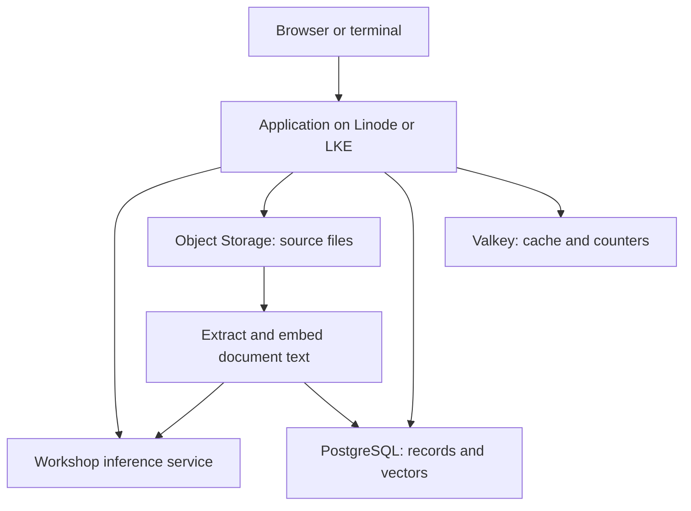

# Akamai Cloud essentials

[Workshop home](../README.md) · [Live session](workshop.md) · [Choose a project path](build.md)

An AI application has ordinary application responsibilities: execute code, store data, accept requests, and call other services. The model is one service in that system.

## Follow one request

The workshop example answers questions from a small collection of documents. The complete starter can use this arrangement; each cloud component is optional until your project needs it.

The application retrieves relevant document text, includes that text in a chat request, and returns the answer. The application also controls which functions a model may request and executes those functions itself. A model call does not run your application code.

## Choose a runtime

A runtime is where your application process executes. The workshop inference service already runs the models; your web API or agent can call it from a CPU instance.

| Choice | What runs there | What Akamai manages | What you manage | Workshop use |
|---|---|---|---|---|
| Linode | Linux processes, containers, APIs, workers | Virtual machine infrastructure | OS updates, application, container configuration, access | One API and a Valkey container with Docker Compose |
| LKE | Containers scheduled as Kubernetes Pods on worker nodes | Kubernetes control plane | Workload manifests, images, secrets, node capacity, application | The same API behind a LoadBalancer Service |

Choose a Linode for a single service when your team knows Linux or Docker. Choose LKE when your team already uses Kubernetes or needs to coordinate several containerized services. LKE introduces cluster and workload configuration in addition to the application itself.

Standard LKE includes a control plane at no additional charge. Worker nodes, load balancers, storage, and paid add-ons have their own charges. See [LKE documentation](https://techdocs.akamai.com/cloud-computing/docs/linode-kubernetes-engine).

## Choose where data lives

| Need | Service | Access pattern | Example |
|---|---|---|---|
| Uploads, images, source documents, exports | Object Storage | S3 API: bucket and object key | Save a generated PNG or a document for retrieval |
| Filesystem space attached to compute | Block Storage | Mount a volume as a disk | A workload that expects files on a persistent volume |
| Structured records and transactions | Managed PostgreSQL or MySQL | SQL connection | Users, tasks, orders, conversation messages |
| Similarity search alongside records | Managed PostgreSQL with pgvector | SQL with vector distance | Store document chunks and their embeddings |
| Temporary cached results and counters | Valkey | Key-value commands with expiry | Reuse an embedding for a repeated query |

The starter uses PostgreSQL, not MySQL, because its schema and queries use pgvector. Object Storage holds the original documents; PostgreSQL holds searchable text chunks and vectors. A bucket does not perform semantic search on its own. Block Storage is a service comparison here, not a required lab.

Object Storage is independent of a VM and uses an S3-compatible API. Check supported operations and the bucket's endpoint when adapting existing S3 code. A Block Storage volume behaves like a disk and has different attachment and filesystem requirements.

## Connect the services

Use Cloud Manager to inspect resources and the Linode CLI to create or update them. Both use the same account. The workshop scripts default to Seattle (`us-sea`) and its Object Storage endpoint; check availability before deploying.

A Cloud Firewall filters network traffic to the VM. A database allow list controls which source addresses may connect to the database. A NodeBalancer forwards requests to application instances; on LKE a Service of type `LoadBalancer` provisions one. Credentials are still required where the service expects them.

Keep the team inference key in the backend. The inference key, Linode personal access token, Object Storage access key, and database credentials have different purposes and are not interchangeable.

## Check your understanding

A user uploads a PDF, asks a question, and returns tomorrow to continue the conversation. Where would you put each part?

- Original PDF: Object Storage; extract its text before indexing.
- Searchable chunks and vectors: PostgreSQL with pgvector.
- Conversation messages: PostgreSQL.
- Request handling and tool execution: a Linode or LKE workload.
- Text generation and embeddings: the shared inference service.

Sources: [Compute](https://techdocs.akamai.com/cloud-computing/docs/create-a-compute-instance), [Object Storage](https://techdocs.akamai.com/cloud-computing/docs/object-storage), [Block Storage](https://techdocs.akamai.com/cloud-computing/docs/block-storage), [PostgreSQL](https://techdocs.akamai.com/cloud-computing/docs/aiven-postgresql), [pgvector support](https://www.akamai.com/blog/developers/2025/aug/open-source-fully-managed-aiven-powered-databases-on-akamai).
